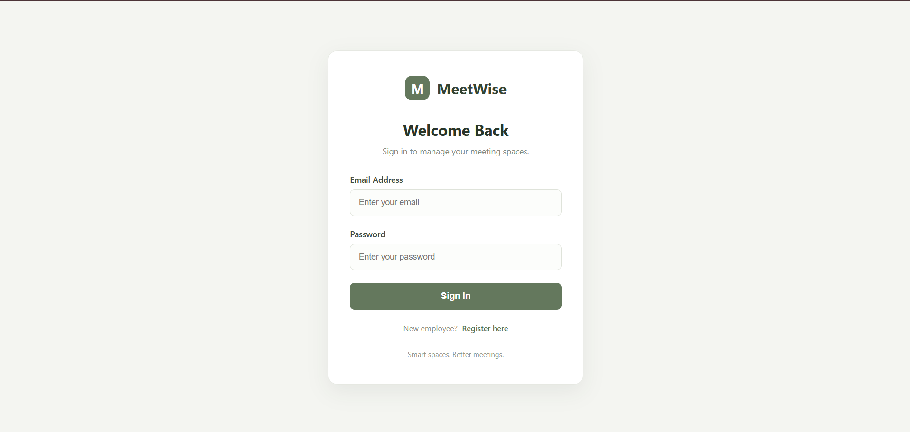
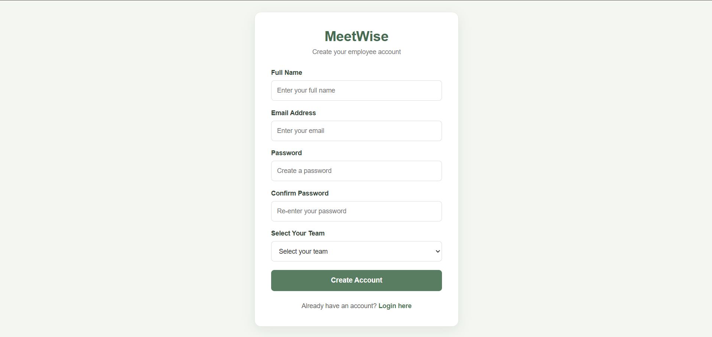
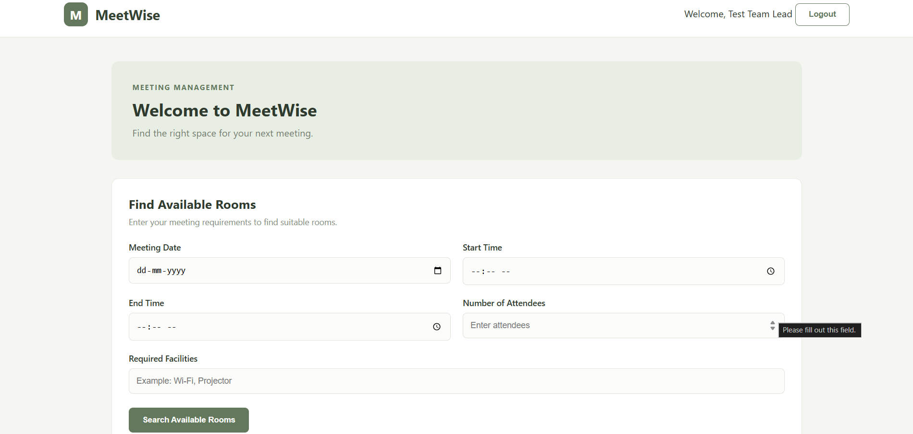
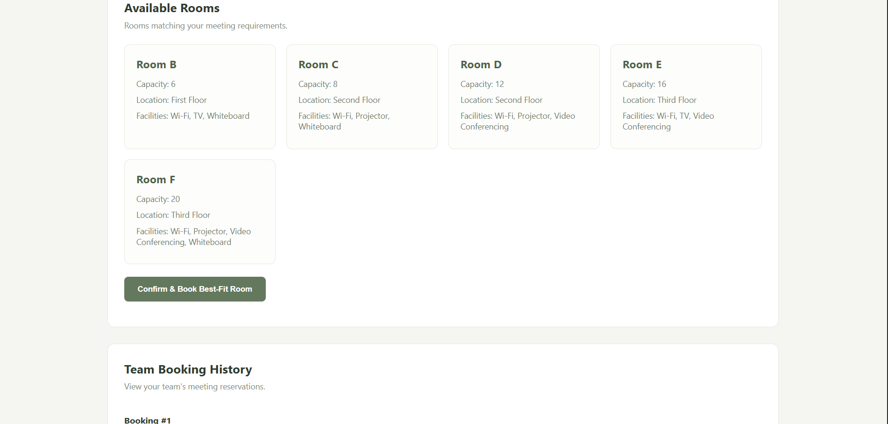

# MeetWise – Smart Meeting Room Booking System

<p align="center">
  <strong>A Role-Based Web Application for Smart Meeting Room Management</strong>
</p>

<p align="center">
  
  
  
  
  
  
</p>

---

## 📌 Project Overview

**MeetWise** is a role-based meeting room booking web application developed using Java, Servlets, JDBC, and MySQL.

It enables employees and team leads to check meeting room availability and manage meeting room reservations, while administrators manage users, teams, and meeting rooms.

The application provides role-based access control, session-based authentication, password hashing, and centralized booking management to simplify meeting room allocation and improve organizational efficiency.

## ✨ Key Features

### 👨‍💼 Admin Module

- Manage users and their roles.
- Create and manage teams.
- Add, update, and manage meeting rooms.
- View and manage meeting bookings.
- Centralized management of application resources.

### 👨‍💻 Team Lead Module

- Search for available meeting rooms.
- Book meeting rooms.
- View booking history.
- Cancel existing bookings.
- Manage meeting reservations.

### 👤 Employee Module

- Search for available meeting rooms.
- View team booking history.
- Access features based on assigned roles.

## 🔐 Authentication & Security

- **Session-Based Authentication:** Maintains user sessions after successful login.
- **Password Hashing:** Protects user passwords using password hashing.
- **Role-Based Authorization:** Restricts application access according to user roles.
- **Logout Functionality:** Allows users to securely end their sessions.

## 🛠️ Technologies Used

| Technology | Purpose |
|---|---|
| Java | Backend development |
| Java Servlets | Request handling and controllers |
| JDBC | Database connectivity |
| MySQL | Relational database |
| HTML | Web page structure |
| CSS | Styling and layout |
| JavaScript | Client-side functionality |
| Apache Tomcat 9 | Web application server |
| Eclipse IDE | Development environment |

## 🏗️ Project Architecture

MeetWise follows the **MVC (Model-View-Controller) architecture** with separate Service and DAO layers to maintain code organization, separation of concerns, and maintainability.

### Architecture Components

| Layer | Responsibility |
|---|---|
| View | HTML, CSS, and JavaScript |
| Controller | Java Servlets |
| Model | Java data classes |
| Service | Business logic and application operations |
| DAO | Database operations using JDBC |
| Database | MySQL |

### Application Flow

```text
       User Interface
     (HTML, CSS, JavaScript)
              |
              v
       Controller Layer
        (Java Servlets)
              |
              v
        Service Layer
       (Business Logic)
              |
              v
          DAO Layer
       (JDBC Operations)
              |
              v
         MySQL Database
```

## 📂 Project Structure

```text
MeetWise/
│
├── src/
│   └── main/
│       ├── java/
│       │   └── com/meetwise/
│       │       ├── controller/
│       │       ├── model/
│       │       │   ├── Data/
│       │       │   ├── dao/
│       │       │   ├── design/
│       │       │   └── service/
│       │       └── util/
│       │
│       └── webapp/
│           ├── WEB-INF/
│           ├── css/
│           ├── js/
│           ├── login.html
│           ├── register.html
│           ├── dashboard.html
│           └── admin-dashboard.html
│
├── screenshots/
│   ├── login.png
│   ├── register.png
│   ├── dashboard.png
│   └── available-rooms.png
│
├── .gitignore
├── README.md
└── .project
```

## 🖥️ Application Screenshots

### 1. Login Page

The login interface allows registered users to access the application using their email address and password.



### 2. Employee Registration

New employees can create an account by entering their personal details and selecting their team.



### 3. Team Lead Dashboard

The dashboard allows team leads to search for available meeting rooms by entering meeting dates, time slots, attendee count, and required facilities. It also provides access to team booking history.



### 4. Available Meeting Rooms

Displays available rooms with their capacity, location, and facilities, allowing users to identify suitable meeting spaces.



## ⚙️ Installation & Setup

### Prerequisites

Make sure the following software is installed:

- JDK
- Eclipse IDE
- Apache Tomcat 9
- MySQL Server
- MySQL Connector/J

### Step 1: Clone the Repository

```bash
git clone https://github.com/nandakishore36/MeetWise.git
```

### Step 2: Import Project into Eclipse

1. Open Eclipse IDE.
2. Navigate to **File → Import**.
3. Select **General → Existing Projects into Workspace**.
4. Browse to the cloned MeetWise project folder.
5. Select the project and click Finish.

### Step 3: Configure Apache Tomcat

1. Open Eclipse.
2. Navigate to the Servers tab.
3. Add Apache Tomcat 9.
4. Configure the Tomcat installation directory.
5. Add the MeetWise project to the server.

### Step 4: Configure MySQL Database

1. Start MySQL Server.
2. Create the required database.
3. Create the required tables.
4. Configure database connection details in the application's database configuration.
5. Ensure the MySQL Connector/J driver is available.

**Note:** Configure your own database credentials locally. Never upload database passwords or private configuration files to GitHub.

### Step 5: Run the Application

1. Right-click the MeetWise project in Eclipse.
2. Select **Run As → Run on Server**.
3. Choose Apache Tomcat 9.
4. Click Finish.
5. Open the application in your browser.

## 🔮 Future Enhancements

- Email notifications for booking confirmations.
- Calendar integration.
- Advanced booking reports and analytics.
- Improved responsive design for mobile devices.
- Automated conflict detection for overlapping reservations.

## 🎯 Learning Outcomes

Through this project, I gained practical experience in:

- Java web application development.
- Java Servlets and JDBC.
- MVC architecture implementation.
- DAO and Service layer design.
- MySQL database integration.
- Session management and authentication.
- Role-based access control.
- Frontend and backend integration.
- Deploying Java web applications using Apache Tomcat.
- Version control and project management using Git and GitHub.

## 👨‍💻 Author

**Nanda Kishore**

Java Web Development Project

GitHub: [@nandakishore36](https://github.com/nandakishore36)

---

<p align="center">
  <strong>MeetWise – Making Meeting Room Management Smarter!</strong>
</p>